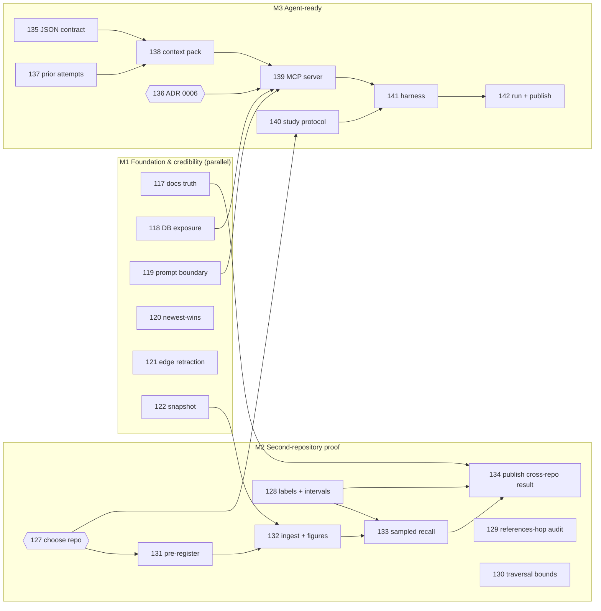

# Roadmap

*Written 2026-10-16 from an audit of `main` at `74a955d`. Issue numbers are GitHub issues in
this repository. Their dependencies are recorded as GitHub "blocked by" relationships, and
repeated in each issue body.*

## What TraceMind is for

**Understand why code exists, trace what a change could affect, recover the decisions and
evidence behind earlier work — and hand the same evidence to a coding agent before it
modifies the repository. Say so when the evidence is not there.**

What makes it different is not retrieval breadth. It is three things, which stay the
non-negotiable core of every item below:

1. **Every claim is evidence-tiered and traceable** to artifacts a reader can open.
2. **Refusal is a first-class result.** It names how something ended, and never invents why.
3. **Mechanical rules, enforced in the database**, decide what counts as a decision — not a
   model's judgement.

The roadmap therefore optimises for *demonstrated* value. A feature ships with the
measurement that shows it works, or it waits behind an evidence gate.

**Primary users, in order:** maintainers and engineers on a repository with a real review
culture; coding agents working in that repository (through the JSON contract or MCP);
engineering leads reading the report. **Not** a target: organisations wanting search across
Slack, Jira and docs — see Out of scope.

## Milestones and the two proofs

**Smallest end-to-end proof on a second repository — M2** (#127 → #131 → #132 → #133 →
#134). Pre-registered queries and predictions, ingestion into its own database, human
adjudication with intervals, and a sampled recall estimate. Its only hard prerequisites
outside M2 are a restored database with a snapshot of the flask graph (#122) and accurate
documents to publish into (#117).

**Proof of value to a coding agent — M3** (#135 → #137 → #138 → #139 → #140 → #141 →
#142). It runs on **today's** capabilities: why, impact, lookup, and prior attempts. It
does not wait for file-level data or declined decisions. A pre-registered study decides
whether the MCP surface is worth maintaining at all (ADR 0006).

M1 runs alongside M2; nothing in M1 gates M2 except the two items above. M4–M7 follow, and
the Research milestone opens only when its named measurements say so.

## Open decisions (owner)

| Issue | Question | Recommendation |
|---|---|---|
| #127 | Second validation repository | **Decided 2026-10-16: `urllib3/urllib3`** (measured: CODEOWNERS, 91% of sampled merged PRs reviewed, release notes cite `#N`, flask-sized) |
| #119 | `dg ask`: drop artifact bodies from the prompt, or fence them | **Decided 2026-10-16: fence them, with an opt-out** |
| #136 | Agent boundary (ADR 0006) | **Accepted 2026-10-16:** versioned JSON plus a read-only MCP stdio adapter |
| #147 | Code granularity and source (ADR 0005) | **Accepted 2026-10-16:** file level from a local clone; symbols later |
| #146 | Confidence, and where co-change lives (ADR 0002) | No numeric score; co-change at query time — **reviewer dissent recorded** |
| #154 | Declined and superseded decisions (ADR 0003) | Prior attempts first; separate `declined_decision` type only after a hand check |
| #159 | Multi-repository use and private repositories (ADR 0007) | Many repositories, one trust domain; private only by explicit opt-in |
| #160 | Storage triggers; polling and webhooks (ADR 0008) | Keep Postgres with measured triggers; one writer |
| #167 | Build the inferred-link proposer? (ADR 0001) | Only if sampled recall (#133) finds prose-only links |
| #168 | Semantic retrieval? (ADR 0004) | Only after the paraphrase benchmark (#144); full-text search before embeddings |

## Every issue, by milestone

### M1 Foundation & credibility

| # | Issue | Priority | Effort | Blocked by |
|---|---|---|---|---|
| #116 | Record architecture decision records and a dependency-aware roadmap | P1 | M | — |
| #117 | The docs describe the project as of Phase 4, present the inference stub as a property of flask, and call H5 a paraphrase | P1 | S | — |
| #118 | The database is published on every host interface as superuser with a fixed public password | P1 | S | — |
| #119 | dg ask sends repository-authored text to the model with no data boundary, and the README says it sends none | P1 | M | — |
| #120 | A stale webhook delivery can overwrite newer state, including merged_at: node and detail upserts are last-writer-wins | P1 | M | — |
| #121 | Extracted edges are never retracted: a closing keyword edited out of a PR body stays as rubric evidence forever | P1 | M | — |
| #122 | The adjudicated flask graph exists only in one local Docker volume: add snapshot export/import | P1 | M | — |
| #123 | A bare `python -m unittest` fails 16 modules on import; running tests on a host needs an undocumented PYTHONPATH | P2 | S | — |
| #124 | --as-of means "first observed", not "written": an edge's valid_from is the artifact's updated_at at ingestion | P2 | M | — |
| #125 | dg ask prose is never checked against its trace: cite-check every artifact and tier the model names | P2 | M | #119 |
| #126 | No SECURITY.md or threat model: repository text, tokens, webhook and model egress are undocumented together | P2 | S | #119, #118 |

### M2 Second-repository proof

| # | Issue | Priority | Effort | Blocked by |
|---|---|---|---|---|
| #127 | Decision needed: which repository is the second validation target **(decision)** | P1 | S | — |
| #128 | Store adjudication labels as data, and report precision, sampled recall and abstention with intervals | P1 | M | — |
| #129 | A Why-walk accepts any Decision it reaches, including one reached through a bare `references` hop into another thread | P1 | M | — |
| #130 | The traversal has a depth bound but no row bound: measure path growth before ingesting a larger repository | P2 | M | — |
| #131 | Pre-register the second repository's query set and predicted yield before ingesting it | P1 | M | #127 |
| #132 | Ingest the second repository into its own database, and publish its figures, recall buckets and round-trip results | P1 | L | #127, #131, #122 |
| #133 | Sampled recall: a human labels a random sample of threads that produced no Decision, on both repositories | P1 | L | #128, #132 |
| #134 | Adjudicate the pre-registered queries on the second repository and publish the cross-repository result | P1 | L | #131, #132, #128, #133, #117 |

### M3 Agent-ready

| # | Issue | Priority | Effort | Blocked by |
|---|---|---|---|---|
| #135 | Versioned JSON output for dg query and dg report, with a published schema | P1 | M | — |
| #136 | Decision needed (ADR 0006): the agent integration boundary — JSON contract, MCP adapter, or HTTP API **(decision)** | P1 | S | #116 |
| #137 | "Have we tried this before?": list prior attempts that did not land, without asserting why | P1 | M | — |
| #138 | Context pack: everything the graph evidences about an issue or PR, with its gaps stated, in one JSON document | P1 | M | #135, #137 |
| #139 | Read-only MCP server exposing why, impact, lookup, prior attempts and context packs to coding agents | P1 | L | #136, #135, #138, #119, #118 |
| #140 | Agent study, part 1: pre-register the protocol, tasks and metrics before any agent runs | P1 | M | #127 |
| #141 | Agent study, part 2: a reproducible harness that runs each task under each condition and records transcripts | P1 | M | #140, #139 |
| #142 | Agent study, part 3: run the pre-registered study, score it blind, and publish the result whatever it is | P1 | L | #140, #141 |

### M4 Evaluation depth

| # | Issue | Priority | Effort | Blocked by |
|---|---|---|---|---|
| #143 | Independently authored queries: a protocol a second person can follow, or an honest record that none was found | P2 | M | #128 |
| #144 | Paraphrase retrieval benchmark: how often a reworded question starts the walk at the right artifact, or a wrong one | P1 | M | #128 |
| #145 | Adversarial repository content: one fixture corpus run through every renderer and every model prompt | P2 | M | #119 |

### M5 Code impact

| # | Issue | Priority | Effort | Blocked by |
|---|---|---|---|---|
| #146 | Decision needed (ADR 0002): numeric confidence or not; co-change as inferred edge or query-time statistic **(decision)** | P2 | S | #116 |
| #147 | Decision needed (ADR 0005): code-intelligence granularity, and whether file data comes from a local clone or the API **(decision)** | P1 | S | #116 |
| #148 | Ingest the files each commit changed: `file` nodes and time-valid `modifies` edges | P1 | L | #147 |
| #149 | Follow files across renames, so a file's history does not end where its path changed | P2 | M | #148 |
| #150 | dg query --path: why does this file look the way it does? | P1 | M | #148 |
| #151 | Impact by file: what usually changes together with these files, labelled as history, not as evidence of a dependency | P2 | M | #148, #146 |
| #152 | CODEOWNERS-aware impact: who owns the files a change touches, using GitHub's last-match-wins rule | P2 | M | #148, #132 |
| #153 | Architecture View: a directory-level map of decisions, change volume, coverage and owners in dg report | P3 | L | #150, #152 |

### M6 Decision history

| # | Issue | Priority | Effort | Blocked by |
|---|---|---|---|---|
| #154 | Decision needed (ADR 0003): how declined and superseded decisions are represented **(decision)** | P2 | S | #116 |
| #155 | Extract who closed each issue and give the closer a mechanical standing, from data already stored in node.raw | P2 | S | — |
| #156 | Read `This reverts commit <sha>` as an explicit supersession, so "we tried this and backed it out" is in the graph | P2 | M | #154 |
| #157 | Declined decisions: a hand-checked mechanical rubric, then a database-enforced `declined_decision` only if it holds | P3 | L | #154, #155, #133 |
| #158 | Decision drift: show how much a Decision's files have changed since it landed, as a count, never as a verdict | P3 | M | #150 |

### M7 Production readiness

| # | Issue | Priority | Effort | Blocked by |
|---|---|---|---|---|
| #159 | Decision needed (ADR 0007): multi-repository support and what TraceMind does with private repositories **(decision)** | P2 | S | #116 |
| #160 | Decision needed (ADR 0008): storage triggers, and how polling and webhooks share one graph **(decision)** | P2 | S | #116 |
| #161 | Record-and-replay GitHub fixtures, so CI can test answers end to end instead of only that input was accepted | P2 | L | #122 |
| #162 | A webhook-delivered merge creates no Decision: the receiver skips reference draining, synthesis and corroboration | P2 | M | #120 |
| #163 | Scheduled polling, with a single-writer lock so two ingests or a poll and the webhook never write at once | P2 | M | #160, #120 |
| #164 | Webhook reliability: de-duplicate deliveries by X-GitHub-Delivery and state how missed deliveries are recovered | P2 | S | #120, #160 |
| #165 | Release process: changelog, version tags, and written criteria for each release | P2 | M | #134 |
| #166 | Several repositories in one database: repo selection in the menu, report, ask and evaluation | P2 | M | #159, #132 |

### Research (evidence-gated)

| # | Issue | Priority | Effort | Blocked by |
|---|---|---|---|---|
| #167 | Decision needed (ADR 0001): whether to build the inferred-link proposer, and with what **(decision)** | P3 | S | #116 |
| #168 | Decision needed (ADR 0004): whether to add semantic retrieval, and only after measuring the gap **(decision)** | P3 | S | #116 |
| #169 | Inferred-link proposer: build it only if the recall audit finds links that explicit extraction misses | P3 | L | #167, #133 |
| #170 | Semantic retrieval: a full-text tier only if the paraphrase benchmark shows a gap; embeddings only if it remains | P3 | M | #168, #144 |

## Considered and not filed

Each of these was weighed during the audit. None is filed, because none has evidence of user
need yet, and filing it would add to the issue count without adding demonstrated value.
Each can come back with evidence, via a new issue that cites it.

| Idea | Why not now | What would bring it back |
|---|---|---|
| PR impact comment (a GitHub Action posting decisions, owners and prior attempts on every PR) | Strong demo value, but it needs file-level impact (#150, #152) and an agent-study result (#142) to justify its noise | #142 shows value, and a maintainer asks for it |
| `dg check --diff`: pre-change check for a working-tree diff | The same machinery as a file-scoped context pack (#138 + #150) | #150 lands; then file it as a thin view |
| Interactive report (graph navigation, timelines) | The static report already browses; interactivity is unmeasured value | Users report the static page as the bottleneck |
| Point-in-time comparison view (what the graph knew at two dates) | `--as-of` exists; its semantics must be fixed first (#124) | #124 lands, plus a concrete use case |
| `dg demo` from a recorded snapshot | Depends on the snapshot and replay infrastructure (#122, #161) | Both land; then a small issue |
| Symbol-level change tracking (tree-sitter on the clone) | ADR 0005 defers it; per-language cost | File-level questions prove insufficient in practice |
| Co-change → affected tests | A statistical guess about tests; needs #151 first | #151 shows reliable signal |
| "Undocumented change" report (merged work with no recorded rationale, by directory) | Partly covered by coverage lines in #150 and #153 | A maintainer asks for it as a standalone report |
| Webhook hosting guide (TLS, reverse proxy, health endpoint) | No deployment exists; #162–#164 come first | Someone runs the receiver for real |
| Numeric confidence scores | ADR 0002 recommends against; nothing to calibrate them on | Per-tier precision (#134) shows tiers too coarse |

## Out of scope

| Item | Reason |
|---|---|
| Slack, Jira, Notion, Confluence ingestion | PRD §4 non-goal. Each is its own extraction-first design problem; the GitHub core is not yet validated beyond one repository |
| Per-user permissions / ACL simulation | PRD §4 non-goal; ADR 0007 chooses one trust domain until a real deployment needs more |
| A dedicated graph database | ADR 0008: Postgres with measured migration triggers |
| An external vector database | ADR 0004: never, before full-text search and pgvector are measured |
| A standalone web application | The self-contained HTML report covers browsing; a web app adds hosting, auth and TLS for unproven value |
| Agent frameworks as dependencies | ADR 0006: one JSON contract plus a thin MCP adapter; no lock-in to a particular agent |
| Any model-written historical claim | The project's cardinal rule. A model may paraphrase what the graph holds, labelled; it never adds a decision, link or reason |

## How this roadmap changes

An issue is added when it has evidence: a file and line, a measurement, or a user request.
Priorities move when a measurement moves them. Decision records change status only through a
PR that records the owner's decision. The issue table above was generated from the filed issues on 2026-10-16;
when issues change, update the table from them rather than editing it to say something
the issues do not.
